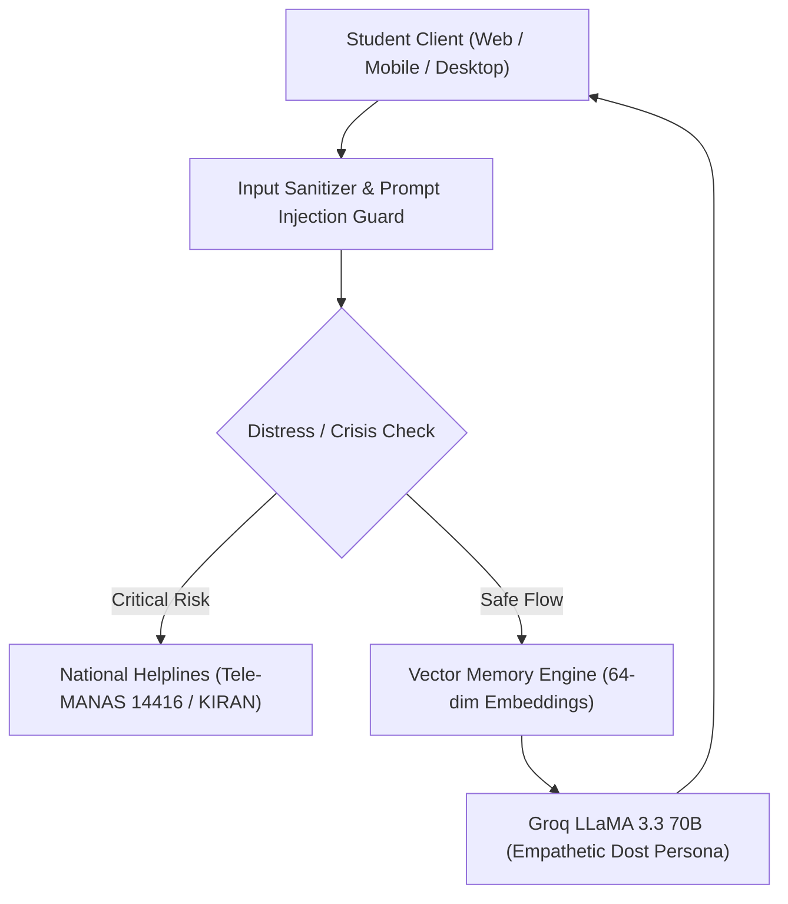

# Manasitra (Friend of the Mind)

Empathetic, multilingual AI emotional companion and mental wellness platform built for Indian students.

[](https://github.com/yashpatadiya1724-cmyk/mansitra_APP/actions/workflows/ci.yml)
[Live demo](https://www.mansitra.in) | [Docs](docs/DESIGN.md) | [License](LICENSE)

  <!-- TODO: owner to add -->

> [!IMPORTANT]
> **Safety & Medical Disclaimer:** Manasitra is an AI peer companion designed for emotional support, academic stress navigation, and daily reflection. **It is not a doctor, licensed therapist, or clinical psychiatric service.** For emergencies, please call **112** or the 24/7 National Mental Health Helpline (Tele-MANAS) at **14416** or KIRAN at **1800-599-0019**.

---

## Features
- **10+ Indian Languages & Dialects:** Cultural emotional empathy in Hindi, Gujarati, Marathi, Bengali, Tamil, Telugu, Kannada, Malayalam, Punjabi, and Hinglish.
- **RAG Long-Term Vector Memory:** 64-dimensional semantic embedding engine that recalls ongoing student challenges (exam pressure, sleep debt, hostel loneliness) across sessions.
- **Automated Crisis Escalation:** Deterministic keyword intercept that instantly surfaces 24/7 national helplines (Tele-MANAS `14416`, KIRAN `1800-599-0019`) whenever severe distress or self-harm intent is detected.
- **Privacy-First Ephemeral Design:** Zero personal identifiable information (PII) is stored in server logs; conversations remain private.
- **Low-Latency Inference:** Powered by Groq LLaMA 3.3 70B for near-instant conversational responses.

## Tech Stack
- **Frontend:** React, Vite, Tailwind CSS, Electron (Desktop), Capacitor (Android / iOS)
- **Backend:** Node.js, Express, Helmet, Morgan, Express Rate Limit
- **Database & Storage:** Supabase (Relational & Auth), LocalForage (IndexedDB client cache)
- **AI & Memory:** Groq Cloud SDK (LLaMA 3.3 70B), Custom In-Memory Vector Store / Cosine Similarity Engine
- **Deployment:** Vercel (Web Frontend), Railway / Docker (Backend API)

## Architecture



## Getting Started

### Prerequisites
- Node.js 18+ (tested on Node 20 and 24)
- Groq API Key (from [console.groq.com](https://console.groq.com))
- Docker & Docker Compose (optional for containerized deployment)

### Setup
1. Clone the repository:
   ```bash
   git clone https://github.com/yashpatadiya1724-cmyk/mansitra_APP.git
   cd mansitra_APP
   ```

2. Configure environment:
   ```bash
   cp .env.example .env
   # Add your GROQ_API_KEY in .env
   ```

3. Install dependencies:
   ```bash
   # Backend
   cd backend && npm install

   # Frontend
   cd ../manasitra-web && npm install
   ```

4. Run tests:
   ```bash
   cd ../backend
   npm test
   ```

5. Start the backend:
   ```bash
   npm start
   ```

6. In a separate terminal, start the frontend:
   ```bash
   cd manasitra-web
   npm run dev
   ```

### Docker
```bash
docker compose up -d
```

## Environment Variables

| Variable | Required | Description |
|---|---|---|
| `PORT` | No | Server port (default: 5000) |
| `NODE_ENV` | No | `development` or `production` |
| `GROQ_API_KEY` | Yes | API key for Groq LLaMA 3.3 70B inference |
| `CORS_ORIGIN` | No | Allowed frontend origin (e.g., `https://www.mansitra.in`) |

## API Reference

| Method | Endpoint | Description |
|---|---|---|
| `POST` | `/api/chat` | Main conversational endpoint with streaming Groq response |
| `POST` | `/api/memory/store` | Stores emotional episodic memory vectors |
| `POST` | `/api/memory/query` | Retrieves relevant past conversational context via semantic search |
| `GET` | `/api/safety/helplines` | Fetches verified 24/7 Indian crisis helplines and medical disclaimers |
| `POST` | `/api/safety/classify` | Evaluates message risk classification |
| `GET` | `/health` | Service health check |

## Security and Privacy
- **Medical Disclaimer**: Manasitra is strictly an AI wellness and emotional support tool, not a doctor or therapist.
- **No PII Logging**: Morgan HTTP logger logs only HTTP verb, status code, and latency — never user text or IP payloads.
- **Input Sanitization**: Guards against prompt injection attacks (`ignore previous instructions`, jailbreak tokens).
- **Rate Limiting**: IP-based sliding window rate limiter protects endpoints against automated scraping and abuse.
- **Crisis Escalation**: Intercepts emergency distress cues and routes directly to Tele-MANAS `14416` and KIRAN `1800-599-0019`.
- **Known Limitations**: AI responses can occasionally have nuanced tone variations; safety screening combines deterministic regex filtering with AI classification.

## Roadmap
- [x] **Done:** Multilingual prompt engineering across 10 Indian regional languages
- [x] **Done:** Semantic vector memory RAG engine (tested in `backend/test/vector_memory_test.js`)
- [x] **Done:** National helpline crisis interception (Tele-MANAS `14416` & KIRAN `1800-599-0019`, tested in `backend/test/crisis_escalation_test.js`)
- [x] **Done:** Docker Compose multi-stage build & automated GitHub Actions CI
- [ ] **Planned:** On-device offline fallback model (Manasitra Local Whisper/Nano)
- [ ] **Planned:** End-to-end encrypted local SQLCipher journal
- [ ] **Planned:** pgvector long-term persistence (gated with explicit consent & user deletion path per `docs/PRIVACY.md`)

## What I Learned
- Balancing conversational empathy with strict safety boundaries is the most critical engineering challenge in mental health tech.
- Pure LLM-based crisis detection has latency; having a deterministic regex rule gate in front of the LLM guarantees zero-latency emergency hotline surfacing.
- Sub-word tri-gram semantic shingles offer resilient similarity search without needing a heavy cloud vector database for edge use cases.

## Author
Yash Patadiya: [LinkedIn](https://www.linkedin.com/in/yash-patadiya-973161272/)

## License
MIT
