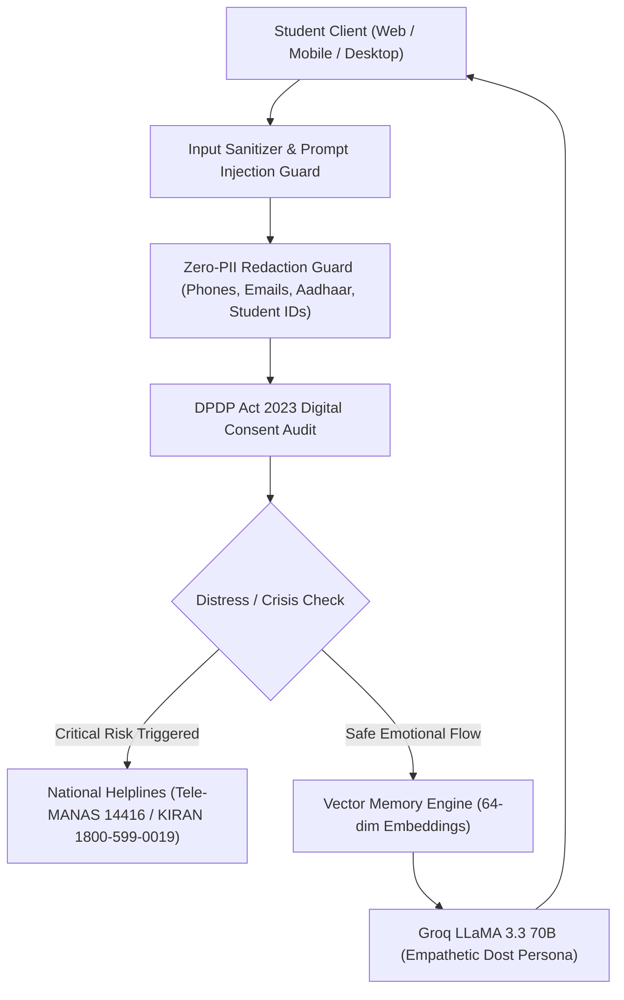

# Manasitra (Friend of the Mind)

Empathetic, multilingual AI emotional companion and mental wellness platform built for Indian students.

[](https://github.com/yashpatadiya1724-cmyk/mansitra_APP/actions/workflows/ci.yml) [](LICENSE) [](https://www.mansitra.in)

[🌐 Live Demo (mansitra.in)](https://www.mansitra.in) | [📖 Design Specs](docs/DESIGN.md) | [🔒 Privacy & Disclaimers](#-privacy-policy-dpdp-act-2023--clinical-disclaimer) | [⚖️ License](LICENSE)

<p align="center">
  
</p>

> [!IMPORTANT]
> **Safety & Medical Disclaimer:** Manasitra is an AI peer companion designed for emotional support, academic stress navigation, and daily reflection. **It is not a doctor, licensed therapist, or clinical psychiatric service.** For emergencies or acute distress, call **112** or the 24/7 National Mental Health Helpline (Tele-MANAS) at **14416** or KIRAN at **1800-599-0019**.

---

## Features
- **10+ Indian Languages & Dialects:** Cultural emotional empathy in Hindi, Gujarati, Marathi, Bengali, Tamil, Telugu, Kannada, Malayalam, Punjabi, and Hinglish.
- **RAG Long-Term Vector Memory:** 64-dimensional semantic embedding engine that recalls ongoing student challenges (exam pressure, sleep debt, hostel loneliness) across sessions.
- **Automated Crisis Escalation:** Deterministic keyword intercept that instantly surfaces 24/7 national helplines (Tele-MANAS `14416`, KIRAN `1800-599-0019`) whenever severe distress or self-harm intent is detected.
- **Zero-PII Privacy & DPDP Act 2023 Compliance:** Pre-inference regex redaction of student mobile numbers, email addresses, 12-digit Aadhaar IDs, and university roll numbers.
- **Low-Latency Inference:** Powered by Groq LLaMA 3.3 70B for near-instant conversational responses.

## Tech Stack
- **Frontend:** React, Vite, Tailwind CSS, Electron (Desktop), Capacitor (Android / iOS)
- **Backend:** Node.js, Express, Helmet, Morgan, Express Rate Limit
- **Database & Storage:** Supabase (Relational & Auth), LocalForage (IndexedDB client cache)
- **AI & Memory:** Groq Cloud SDK (LLaMA 3.3 70B), Custom In-Memory Vector Store / Cosine Similarity Engine
- **Deployment:** Vercel (Web Frontend), Railway / Docker (Backend API)

## Architecture



---

## 🔒 Privacy Policy, DPDP Act 2023 & Clinical Disclaimer

### 1. Clinical & Medical Boundary Notice
- **Non-Diagnostic Tool:** Manasitra is strictly an AI-driven peer companion and reflective psychoeducational journal. It does **not** provide clinical diagnosis, psychiatric evaluations, or medical prescriptions.
- **Crisis Hotlines:** If you or someone you know is undergoing acute emotional distress or contemplating self-harm, please reach out to India's dedicated 24/7 toll-free crisis hotlines immediately:
  - **Tele-MANAS (Govt. of India):** Dial `14416` or `1800-891-4416` (24x7 multi-lingual support)
  - **KIRAN Helpline:** Dial `1800-599-0019` (Ministry of Social Justice & Empowerment)
  - **Vandrevala Foundation:** `+91 9999 666 555` (Free professional tele-counseling)
  - **National Emergency Response:** Dial `112`

### 2. Digital Personal Data Protection (DPDP) Act 2023 Compliance
- **Zero-PII Storage:** Student phone numbers, email addresses, Indian Aadhaar numbers, and university enrollment IDs are scrubbed on-the-fly (`backend/services/privacyService.js`) using high-performance regex filters before any payload reaches LLM inference.
- **Client-Side Data Ownership:** Conversations are cached in the browser or on the device using IndexedDB (`localforage`). Raw chat histories are never permanently retained in cloud server databases.
- **Consent Architecture (Section 6 DPDP):** Every student session receives an immutable cryptographic consent receipt with explicit purpose tracking (`EMOTIONAL_PEER_SUPPORT`) and immediate revocation rights (`/api/privacy/consent/revoke`).
- **Grievance Redressal:** In compliance with Section 13 of the DPDP Act 2023, privacy inquiries or data erasure requests can be directed to `privacy@mansitra.in`.

---

## Getting Started

### Prerequisites
- Node.js 18+ (tested on Node 20 and Node 24)
- Groq API Key (from [console.groq.com](https://console.groq.com))
- Docker & Docker Compose (optional for containerized deployment)

### Setup Steps
1. **Clone the repository:**
   ```bash
   git clone https://github.com/yashpatadiya1724-cmyk/mansitra_APP.git
   cd mansitra_APP
   ```

2. **Configure environment:**
   ```bash
   cp .env.example .env
   # Add your GROQ_API_KEY in .env
   ```

3. **Install dependencies:**
   ```bash
   # Backend dependencies
   cd backend && npm install

   # Frontend web dependencies
   cd ../manasitra-web && npm install
   ```

4. **Run automated verification tests (100% pass):**
   ```bash
   cd ../backend
   npm test
   ```

5. **Start the backend development server:**
   ```bash
   npm start
   # Server runs on http://localhost:3001
   ```

6. **In a separate terminal, launch the frontend:**
   ```bash
   cd manasitra-web
   npm run dev
   # App runs on http://localhost:5173
   ```

### Docker
```bash
docker compose up -d
```

## Environment Variables

| Variable | Required | Description |
|---|---|---|
| `PORT` | No | Server port (default: 3001) |
| `NODE_ENV` | No | `development` or `production` |
| `GROQ_API_KEY` | Yes | API key for Groq LLaMA 3.3 70B inference |
| `ALLOWED_ORIGINS` | No | Allowed frontend origin (e.g., `https://www.mansitra.in`) |

## API Reference

| Method | Endpoint | Description |
|---|---|---|
| `POST` | `/api/chat` | Main conversational endpoint with streaming Groq response |
| `POST` | `/api/memory/store` | Stores emotional episodic memory vectors |
| `POST` | `/api/memory/query` | Retrieves relevant past conversational context via semantic search |
| `GET` | `/api/safety/helplines` | Fetches verified 24/7 Indian crisis helplines and medical disclaimers |
| `POST` | `/api/safety/classify` | Evaluates message risk classification |
| `GET` | `/api/privacy/disclaimer` | Returns statutory clinical disclaimer and emergency escalations |
| `POST` | `/api/privacy/consent/record` | Issues an immutable DPDP Act 2023 digital consent receipt |
| `POST` | `/api/privacy/sanitize-preview` | Previews zero-PII redaction without triggering LLM calls |
| `GET` | `/health` | Service health check |

## Automated Verification Suite

Run all test suites with:
```bash
cd backend && npm test
```

- `test/vector_memory_test.js`: 64-dim embeddings & semantic cosine similarity retrieval.
- `test/crisis_escalation_test.js`: Emergency keyword intercept & prompt injection safety.
- `test/privacy_disclaimer_test.js`: PII phone/email/Aadhaar scrubbing, DPDP consent receipts, & clinical disclaimer validation.

---

## Author & Connect
Yash Patadiya: [LinkedIn](https://www.linkedin.com/in/yash-patadiya-973161272/) · [Mansitra](https://www.mansitra.in) · [Email](mailto:yashpatadiya1724@gmail.com)

## License
MIT
